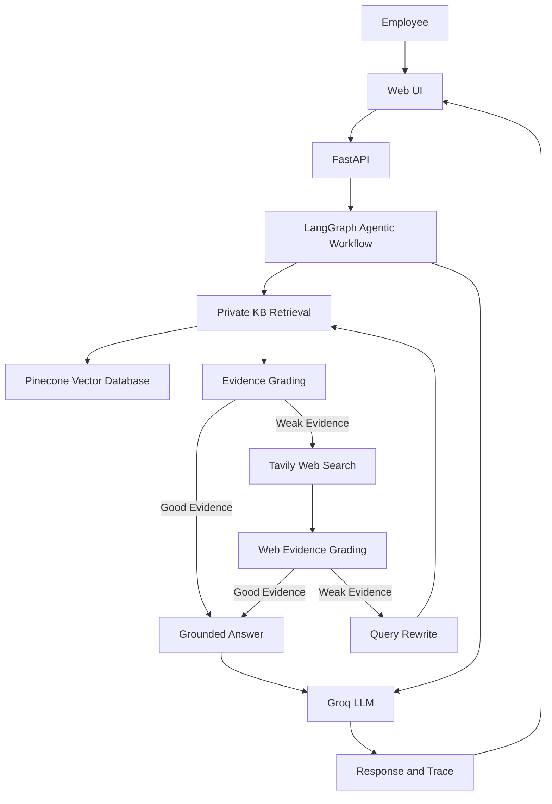
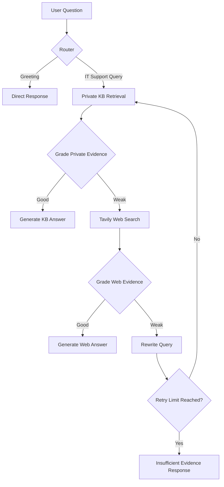
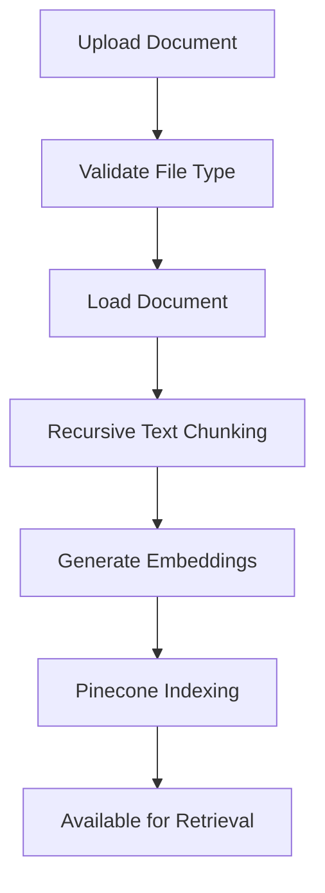

# nexusit-ai
An Agentic RAG Copilot for Enterprise IT Support — leveraging LLMs, LangGraph, knowledge retrieval, and AI-powered tools to automate troubleshooting and incident resolution.

conda create -n project python=3.11 -y

conda activate project

pip install -r requirements.txt

# NexusIT AI
### Enterprise IT Support Copilot powered by Agentic RAG

> An intelligent IT support copilot that retrieves enterprise knowledge, evaluates evidence, dynamically selects information sources, and orchestrates agentic workflows to deliver grounded IT support.

---

## Overview

**NexusIT AI** is an Agentic Retrieval-Augmented Generation (RAG) application designed to solve common enterprise IT support challenges.

Built around a fictional enterprise, **NovaRetail**, a 3,000-employee retail organization, the platform helps employees resolve IT issues using trusted internal documentation, intelligent retrieval, evidence evaluation, and external web search when internal knowledge is insufficient.

Unlike traditional RAG pipelines that follow a simple retrieve-and-generate approach, NexusIT AI uses a stateful agentic workflow to route queries, grade retrieved evidence, rewrite queries, retry retrieval, and select appropriate knowledge sources before generating responses.

The goal is to transform enterprise IT knowledge into an intelligent, interactive and transparent support experience.

## Business Problem

Enterprise IT teams maintain extensive knowledge bases containing:

- IT policies and security guidelines
- VPN and network troubleshooting guides
- Password reset procedures
- MFA policies
- Software installation instructions
- Service desk runbooks
- IT operational documentation

Employees often struggle to find the right information, resulting in repetitive support tickets and inefficient IT operations.

Traditional keyword-based search and basic chatbots may return irrelevant information or generate answers without sufficient evidence.

NexusIT AI addresses these challenges through intelligent retrieval, evidence evaluation and agentic decision-making.

## Solution

NexusIT AI provides an AI-powered IT support experience that:

- Prioritizes trusted internal enterprise knowledge.
- Evaluates the relevance and quality of retrieved evidence.
- Uses external web search when internal knowledge is insufficient.
- Rewrites queries and retries retrieval when evidence is weak.
- Generates responses grounded in retrieved information.
- Provides workflow traces for transparency and debugging.
- Supports authorized document ingestion into the knowledge base.

## Architecture



## Agentic RAG Workflow

NexusIT AI implements a conditional, stateful workflow using LangGraph.

### Workflow

1. **Question Routing** – Determines whether the input is a greeting or an IT support query.
2. **Private Knowledge Retrieval** – Searches enterprise documentation stored in Pinecone.
3. **Evidence Grading** – Evaluates whether retrieved knowledge is relevant and sufficient.
4. **Grounded Answer Generation** – Generates an answer using trusted internal knowledge when evidence is sufficient.
5. **External Search Fallback** – Uses Tavily when internal knowledge cannot adequately answer the question.
6. **Web Evidence Grading** – Evaluates the relevance of externally retrieved information.
7. **Query Rewriting** – Improves weak queries to enhance retrieval.
8. **Retry Mechanism** – Reattempts retrieval with rewritten queries while enforcing retry limits.
9. **Response Generation** – Produces an answer based on available evidence.
10. **Workflow Trace** – Exposes the decision path for transparency and debugging.

### Workflow Diagram



### Why Agentic RAG?

Traditional RAG:

```text
Question → Retrieve → Generate
```

NexusIT AI:

```text
Question
   ↓
Route
   ↓
Retrieve
   ↓
Evaluate Evidence
   ↓
Select Knowledge Source
   ↓
Rewrite / Retry if Necessary
   ↓
Generate Grounded Response
```

The system dynamically determines what action to take based on the quality of retrieved evidence and the current workflow state.

---

## Technology Stack

| Component | Technology | Purpose |
|---|---|---|
| Agent Orchestration | LangGraph | Stateful workflow, routing and conditional decisions |
| LLM | Groq | Routing, evidence grading, query rewriting and answer generation |
| Embeddings | HuggingFace `all-MiniLM-L6-v2` | Local text embeddings (384 dimensions) |
| Vector Database | Pinecone | Enterprise knowledge retrieval |
| External Search | Tavily | Web search fallback |
| Backend | FastAPI | REST APIs and application backend |
| Frontend | HTML, CSS, JavaScript | Interactive user interface |
| Audit Logging | SQLite | Basic workflow and decision-path logging |
| Document Processing | Python | Document loading, chunking and ingestion |
| Deployment | Docker | Containerization |

---

## Key Features

### 1. Intelligent Question Routing

Automatically distinguishes between greetings and IT support questions, avoiding unnecessary retrieval operations for simple conversational inputs.

### 2. Private Knowledge-First Retrieval

Searches the enterprise knowledge base before using external information.

Internal knowledge is prioritized for company-specific policies, processes and troubleshooting instructions.

### 3. Evidence Grading

Evaluates retrieved documents to determine whether they sufficiently support an answer.

This helps reduce responses based on irrelevant or insufficient retrieved context.

### 4. Web Search Fallback

Integrates Tavily to retrieve external information when private enterprise knowledge is insufficient.

External-source responses can be distinguished from answers based on internal documentation.

### 5. Query Rewriting and Retry

Reformulates queries when retrieved evidence is weak and retries retrieval through a controlled workflow.

### 6. Transparent Agent Workflow

Provides a trace of the workflow decisions, including retrieval, evidence grading, source selection and answer generation.

### 7. Enterprise Document Ingestion

Allows authorized administrators to upload company documents and add them to the knowledge base without manually modifying the ingestion code.

Supported document formats:

- PDF
- TXT
- Markdown
- DOCX

### 8. Grounded Responses

Generates responses using retrieved evidence instead of relying solely on the LLM's parametric knowledge.

### 9. API-Based Architecture

Exposes core application functionality through REST APIs built using FastAPI.

---

## Sample Use Cases

### Use Case 1: VPN Troubleshooting

**Question:**

> How do I connect to the company VPN from home?

**Expected workflow:**

```text
Router → Private KB Retrieval
       → Evidence Grade: GOOD
       → Grounded Answer
```

The system retrieves the relevant VPN instructions from the private knowledge base without unnecessarily searching the public web.

### Use Case 2: Security Policy

**Question:**

> Can IT support ask me to share my MFA code?

**Expected workflow:**

```text
Router → Private KB Retrieval
       → Evidence Grade: GOOD
       → Policy-Based Answer
```

The copilot retrieves company security policies and provides a response grounded in internal documentation.

### Use Case 3: Current Microsoft Teams Outage Guidance

**Question:**

> What is the latest Microsoft Teams outage guidance?

**Expected workflow:**

```text
Router → Private KB Retrieval
       → Evidence Grade: WEAK
       → Tavily Web Search
       → Web Evidence Grade
       → Grounded External Response
```

When internal knowledge is insufficient, the system searches the web and evaluates the retrieved evidence before generating its response.

### Use Case 4: Query Rewriting

**Question:**

> My work communication app is acting strange after the new update. What should I do?

The system can reformulate the query to improve retrieval and retry the search when the initial evidence is insufficient.

### Use Case 5: Direct Conversation

**Question:**

> Hello!

**Expected workflow:**

```text
Router → DIRECT → Direct Response
```

The system avoids unnecessary vector retrieval or external search for conversational messages.

---

## Document Ingestion Pipeline

Authorized users can add enterprise documents through the application interface.



### Supported Formats

- `.pdf`
- `.txt`
- `.md`
- `.docx`

The ingestion pipeline processes uploaded documents, converts them into chunks, generates embeddings and indexes them in Pinecone for retrieval.

---

## Project Structure

```text
nexusit-ai/
│
├── app/
│   ├── api/
│   │   └── routes.py
│   │
│   ├── core/
│   │   ├── config.py
│   │   └── logging.py
│   │
│   ├── rag/
│   │   ├── state.py
│   │   ├── vectorstore.py
│   │   └── workflow.py
│   │
│   ├── services/
│   │   ├── audit.py
│   │   └── ingestion.py
│   │
│   └── main.py
│
├── data/
│   └── sample_kb/
│       ├── company_it_handbook.md
│       └── service_desk_runbook.md
│
├── static/
│   ├── css/
│   │   └── style.css
│   └── js/
│       └── app.js
│
├── templates/
│   └── index.html
│
├── tests/
│   └── test_ingestion.py
│
├── uploads/
│
├── .env.example
├── .gitignore
├── Dockerfile
├── ingest_sample_kb.py
├── requirements.txt
├── run.py
└── README.md
```

---

## Getting Started

### Prerequisites

- Python 3.10+
- Pinecone account
- Groq API key
- Tavily API key
- OpenAI API key (if using the configured OpenAI embedding or fallback model)

### 1. Clone the Repository

```bash
git clone https://github.com/<your-username>/nexusit-ai.git

cd nexusit-ai
```

### 2. Create a Virtual Environment

```bash
python -m venv venv
```

**Windows**

```bash
venv\Scripts\activate
```

**macOS / Linux**

```bash
source venv/bin/activate
```

### 3. Install Dependencies

```bash
pip install -r requirements.txt
```

### 4. Configure Environment Variables

Create a `.env` file in the project root.

```env
# LLM
GROQ_API_KEY=your_groq_api_key
OPENAI_API_KEY=your_openai_api_key

# External Search
TAVILY_API_KEY=your_tavily_api_key

# Vector Database
PINECONE_API_KEY=your_pinecone_api_key
PINECONE_INDEX_NAME=fde-it-support-rag
PINECONE_NAMESPACE=company-it-kb

# Models
GROQ_MODEL=openai/gpt-oss-20b
OPENAI_MODEL=gpt-4o-mini
EMBEDDING_MODEL=text-embedding-3-small

# Security
ADMIN_API_KEY=replace_with_secure_key

# Application
APP_ENV=development
```

### Environment Variable Reference

| Variable | Description |
|---|---|
| `GROQ_API_KEY` | API key for Groq |
| `OPENAI_API_KEY` | API key for OpenAI |
| `TAVILY_API_KEY` | API key for Tavily |
| `PINECONE_API_KEY` | API key for Pinecone |
| `PINECONE_INDEX_NAME` | Pinecone index name |
| `PINECONE_NAMESPACE` | Knowledge base namespace |
| `GROQ_MODEL` | Groq model identifier |
| `OPENAI_MODEL` | OpenAI model identifier |
| `EMBEDDING_MODEL` | Embedding model identifier |
| `ADMIN_API_KEY` | Key protecting document ingestion endpoints |
| `APP_ENV` | Application environment |

### Security Notes

- Never commit `.env` files.
- Use secure API keys.
- Change the default admin key.
- Store credentials in environment variables.
- Restrict API key access to authorized services.

### 5. Ingest Sample Knowledge Base

```bash
python ingest_sample_kb.py
```

This loads the sample enterprise documents, chunks the text, generates embeddings and indexes the knowledge in Pinecone.

### 6. Run the Application

```bash
python run.py
```

Open the application:

[http://127.0.0.1:8000](http://127.0.0.1:8000)

FastAPI documentation:

[http://127.0.0.1:8000/docs](http://127.0.0.1:8000/docs)

---

## API Documentation

### Health Check

**Endpoint**

```http
GET /api/health
```

Checks the application health.

### Chat

**Endpoint**

```http
POST /api/chat
```

**Request**

```json
{
  "question": "How do I reset my company password?"
}
```

**Example Response**

```json
{
  "answer": "Follow the company password reset instructions...",
  "source_used": "private_kb",
  "trace": [
    "Router → KB",
    "Private KB retrieval → 4 chunks",
    "KB evidence grade → GOOD",
    "Answer generation → PRIVATE KB"
  ],
  "citations": []
}
```

### Document Ingestion

**Endpoint**

```http
POST /api/ingest
```

Uploads and processes a document into the enterprise knowledge base.

**Authentication**

Requires the `X-Admin-Key` header.

---

## Design Principles

- **Knowledge First:** Prioritize trusted internal information.
- **Evidence Driven:** Evaluate retrieved context before generation.
- **Adaptive Retrieval:** Rewrite and retry weak retrieval queries.
- **Source Awareness:** Select private or external sources based on evidence.
- **Transparency:** Expose workflow traces for debugging.
- **Controlled Execution:** Enforce retry limits and protected ingestion endpoints.

---

## Future Enhancements

- Authentication and role-based access control (RBAC)
- Enterprise SSO integration
- ITSM integrations such as ServiceNow and Jira Service Management
- Automated ticket creation and updates
- MCP-based enterprise tool integrations
- Multi-agent collaboration
- Human-in-the-loop approval workflows
- RAG evaluation framework
- Hallucination and faithfulness evaluation
- Observability and monitoring dashboards
- Conversation memory
- Document versioning and access-aware retrieval
- Docker Compose deployment
- Cloud deployment on AWS, Azure or GCP

---

## Project Objective

NexusIT AI demonstrates how Agentic RAG can evolve from a basic retrieval pipeline into a practical enterprise AI application.

The project combines knowledge retrieval, conditional agent workflows, evidence grading, query rewriting, external search, API development and interactive user experience into an end-to-end AI solution.

It explores the engineering challenges of building AI systems that are not only conversational, but also evidence-aware, adaptive, transparent and extensible.

---

## License

This project is licensed under the MIT License.

---

**NexusIT AI — From Enterprise Knowledge to Intelligent IT Support.**
